# Export gallery

Made by `node scripts/gallery.mjs`. Every file here came out of the export dialog of the running app.
Each sheet shows the files as a slide or a document shows them: an image on a white page at 600, 420 and 240 px wide.
The script also writes each PNG (shown on the sheets) and each SVG with its letters as shapes (`*.shapes.svg`); those are large and are not kept in the repository.

| Fixture | Files | Size and check (sketch) |
|---|---|---|
| [activity-fork-either](activity-fork-either.sheet.png) | [sketch svg](activity-fork-either.sketch.svg), [sketch pdf](activity-fork-either.sketch.pdf), [precision svg](activity-fork-either.precision.svg), [precision pdf](activity-fork-either.precision.pdf) | 485 x 583 px, 5.1 x 6.1 in. Smallest text 22px. Layout check: pass. |
| [activity-parallel](activity-parallel.sheet.png) | [sketch svg](activity-parallel.sketch.svg), [sketch pdf](activity-parallel.sketch.pdf), [precision svg](activity-parallel.precision.svg), [precision pdf](activity-parallel.precision.pdf) | 429 x 711 px, 4.5 x 7.4 in. Smallest text 22px. Layout check: pass. |
| [dangling](dangling.sheet.png) | [sketch svg](dangling.sketch.svg), [sketch pdf](dangling.sketch.pdf), [precision svg](dangling.precision.svg), [precision pdf](dangling.precision.pdf) | 250 x 364 px, 2.6 x 3.8 in. Smallest text 22px. Layout check: pass. |
| [flow-approval](flow-approval.sheet.png) | [sketch svg](flow-approval.sketch.svg), [sketch pdf](flow-approval.sketch.pdf), [precision svg](flow-approval.precision.svg), [precision pdf](flow-approval.precision.pdf) | 541 x 810 px, 5.6 x 8.4 in. Smallest text 20px. Layout check: pass. |
| [flow-unlabeled](flow-unlabeled.sheet.png) | [sketch svg](flow-unlabeled.sketch.svg), [sketch pdf](flow-unlabeled.sketch.pdf), [precision svg](flow-unlabeled.precision.svg), [precision pdf](flow-unlabeled.precision.pdf) | 541 x 630 px, 5.6 x 6.6 in. Smallest text 22px. Layout check: pass. |
| [usecase-actor-inside](usecase-actor-inside.sheet.png) | [sketch svg](usecase-actor-inside.sketch.svg), [sketch pdf](usecase-actor-inside.sketch.pdf), [precision svg](usecase-actor-inside.precision.svg), [precision pdf](usecase-actor-inside.precision.pdf) | 367 x 594 px, 3.8 x 6.2 in. Smallest text 20px. Layout check: pass. |
| [usecase-include-reversed](usecase-include-reversed.sheet.png) | [sketch svg](usecase-include-reversed.sketch.svg), [sketch pdf](usecase-include-reversed.sketch.pdf), [precision svg](usecase-include-reversed.precision.svg), [precision pdf](usecase-include-reversed.precision.pdf) | 755 x 220 px, 7.9 x 2.3 in. Smallest text 20px. Layout check: pass. |
| [usecase-is-flow](usecase-is-flow.sheet.png) | [sketch svg](usecase-is-flow.sketch.svg), [sketch pdf](usecase-is-flow.sketch.pdf), [precision svg](usecase-is-flow.precision.svg), [precision pdf](usecase-is-flow.precision.pdf) | 517 x 584 px, 5.4 x 6.1 in. Smallest text 20px. Layout check: pass. |
| [usecase-permit](usecase-permit.sheet.png) | [sketch svg](usecase-permit.sketch.svg), [sketch pdf](usecase-permit.sketch.pdf), [precision svg](usecase-permit.precision.svg), [precision pdf](usecase-permit.precision.pdf) | 1005 x 463 px, 10.5 x 4.8 in. Smallest text 20px. Layout check: pass. |
| [activity-decision-merge](activity-decision-merge.sheet.png) | [sketch svg](activity-decision-merge.sketch.svg), [sketch pdf](activity-decision-merge.sketch.pdf), [precision svg](activity-decision-merge.precision.svg), [precision pdf](activity-decision-merge.precision.pdf) | 663 x 877 px, 6.9 x 9.1 in. Smallest text 20px. Layout check: pass. |
| [activity-lanes](activity-lanes.sheet.png) | [sketch svg](activity-lanes.sketch.svg), [sketch pdf](activity-lanes.sketch.pdf), [precision svg](activity-lanes.precision.svg), [precision pdf](activity-lanes.precision.pdf) | 1043 x 1136 px, 10.9 x 11.8 in. Smallest text 20px. Layout check: pass. |
| [class-orders](class-orders.sheet.png) | [sketch svg](class-orders.sketch.svg), [sketch pdf](class-orders.sketch.pdf), [precision svg](class-orders.precision.svg), [precision pdf](class-orders.precision.pdf) | 471 x 920 px, 4.9 x 9.6 in. Smallest text 20px. Layout check: pass. |
| [class-shapes](class-shapes.sheet.png) | [sketch svg](class-shapes.sketch.svg), [sketch pdf](class-shapes.sketch.pdf), [precision svg](class-shapes.precision.svg), [precision pdf](class-shapes.precision.pdf) | 396 x 772 px, 4.1 x 8.0 in. Smallest text 20px. Layout check: pass. |
| [dense](dense.sheet.png) | [sketch svg](dense.sketch.svg), [sketch pdf](dense.sketch.pdf), [precision svg](dense.precision.svg), [precision pdf](dense.precision.pdf) | 1757 x 2372 px, 18.3 x 24.7 in. Smallest text 20px. Layout check: pass. |
| [flow-branched](flow-branched.sheet.png) | [sketch svg](flow-branched.sketch.svg), [sketch pdf](flow-branched.sketch.pdf), [precision svg](flow-branched.precision.svg), [precision pdf](flow-branched.precision.pdf) | 799 x 962 px, 8.3 x 10.0 in. Smallest text 20px. Layout check: pass. |
| [manual-layout](manual-layout.sheet.png) | [sketch svg](manual-layout.sketch.svg), [sketch pdf](manual-layout.sketch.pdf), [precision svg](manual-layout.precision.svg), [precision pdf](manual-layout.precision.pdf) | 556 x 512 px, 5.8 x 5.3 in. Smallest text 20px. Layout check: pass. |
| [usecase-described](usecase-described.sheet.png) | [sketch svg](usecase-described.sketch.svg), [sketch pdf](usecase-described.sketch.pdf), [precision svg](usecase-described.precision.svg), [precision pdf](usecase-described.precision.pdf) | 953 x 424 px, 9.9 x 4.4 in. Smallest text 20px. Layout check: pass. |

## activity-fork-either

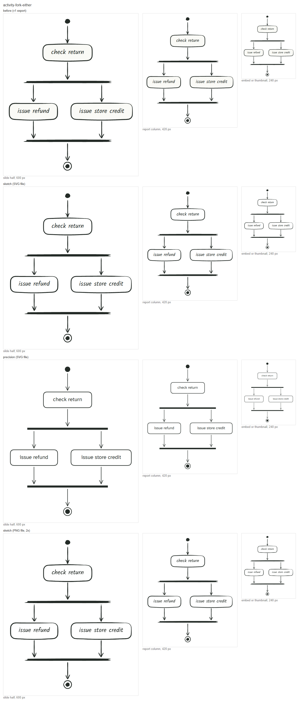

## activity-parallel

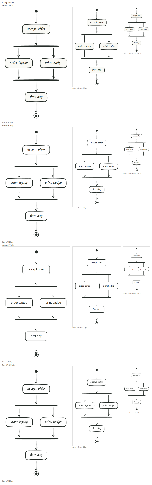

## dangling

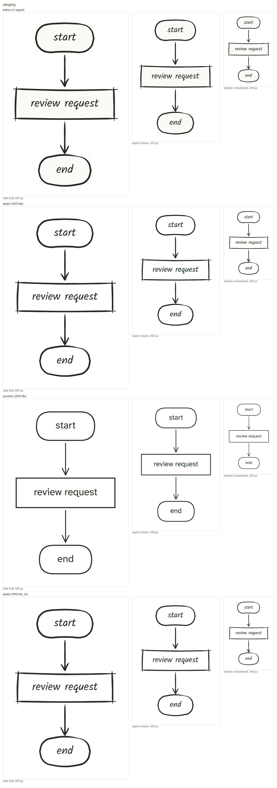

## flow-approval

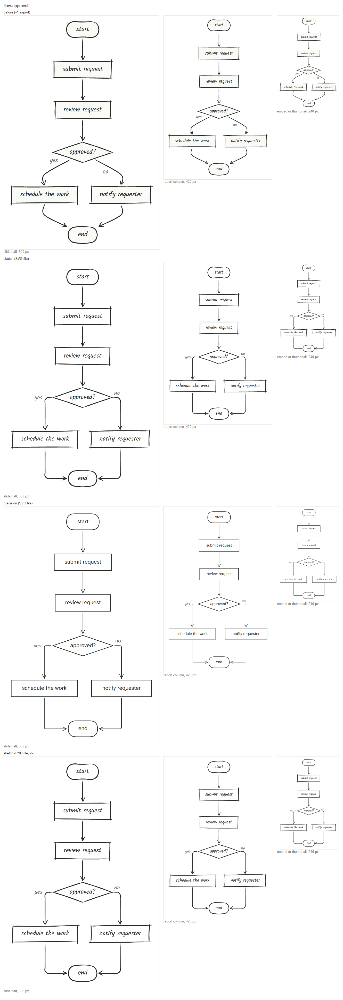

## flow-unlabeled

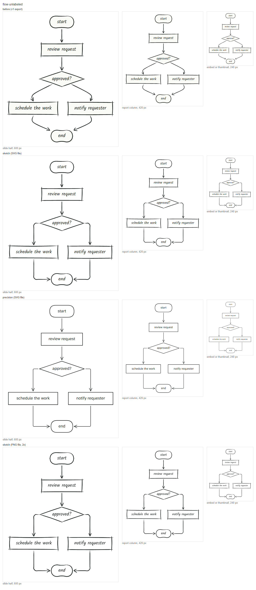

## usecase-actor-inside

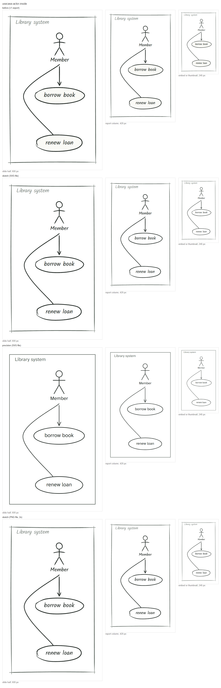

## usecase-include-reversed

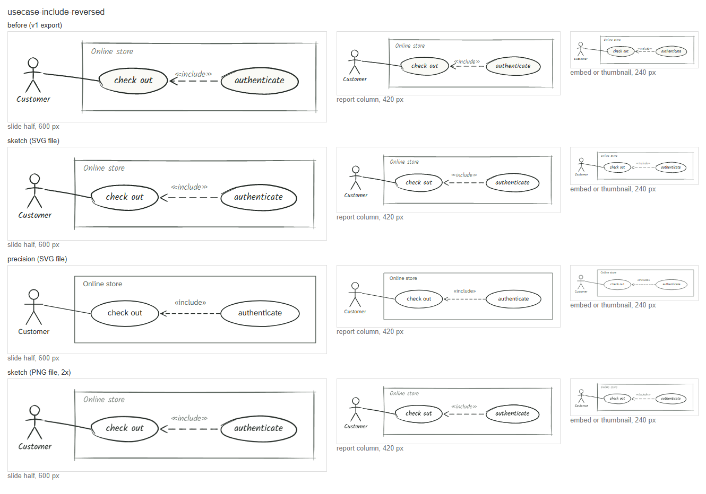

## usecase-is-flow

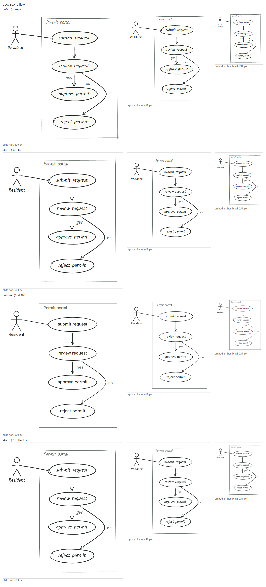

## usecase-permit

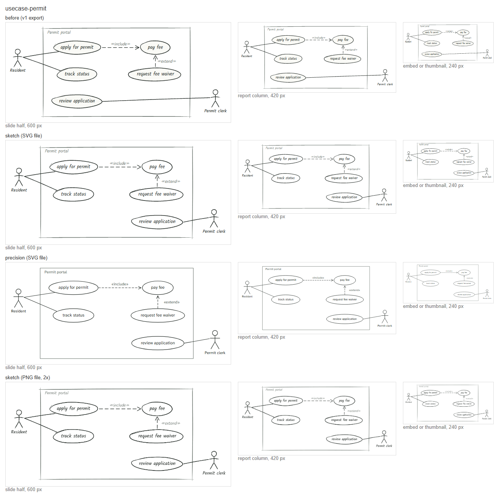

## activity-decision-merge

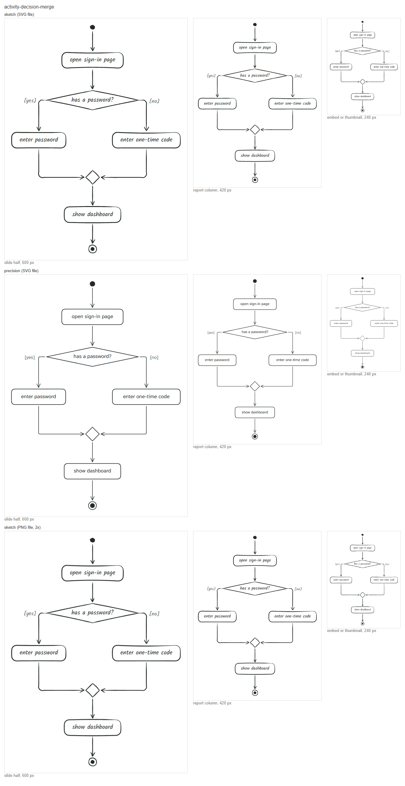

## activity-lanes

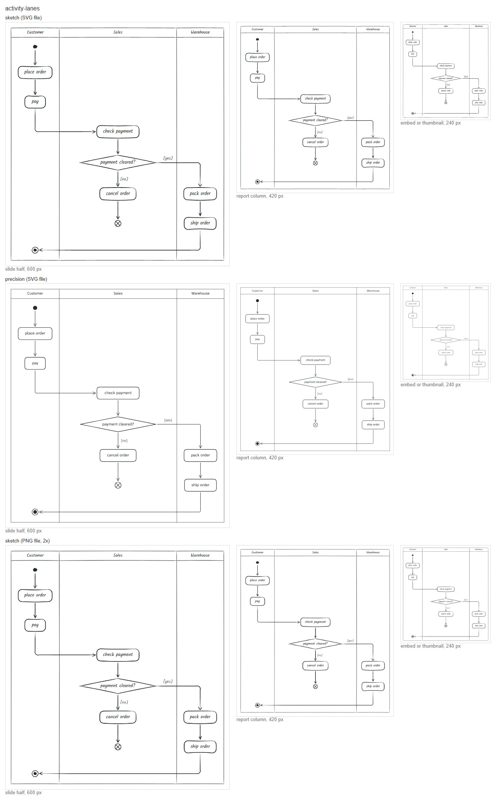

## class-orders

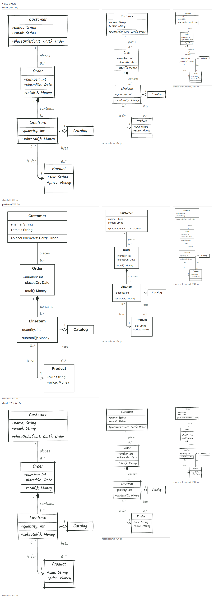

## class-shapes

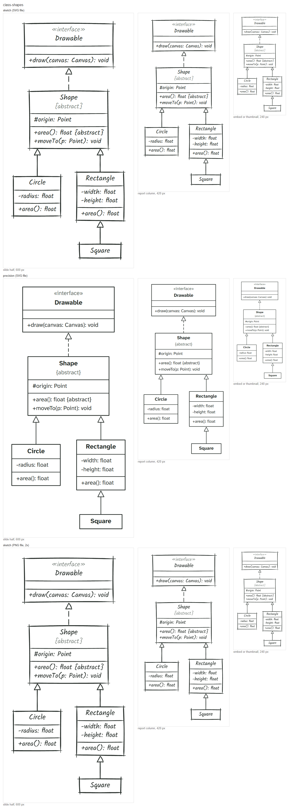

## dense

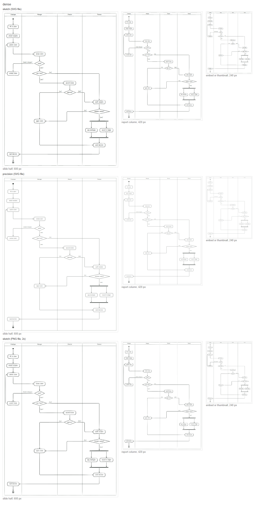

## flow-branched

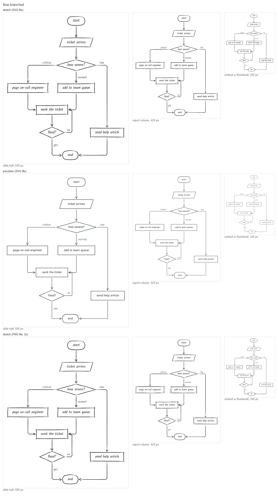

## manual-layout

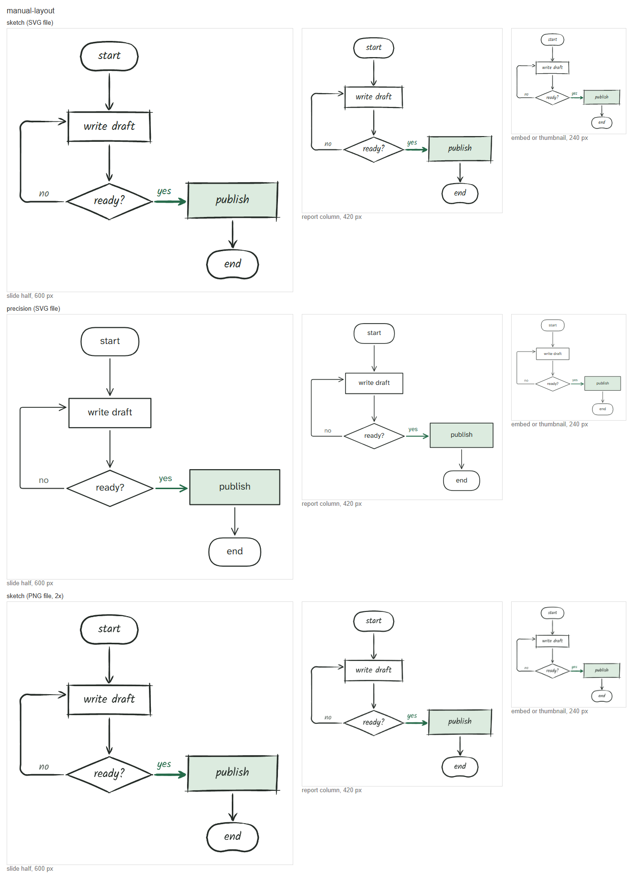

## usecase-described

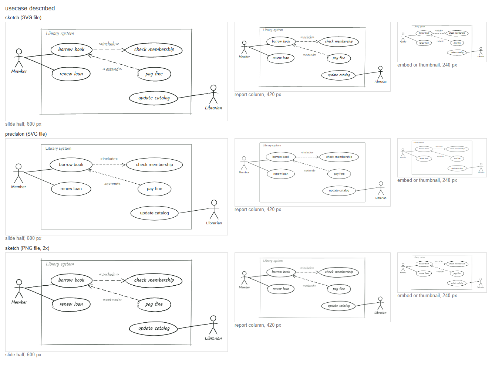
